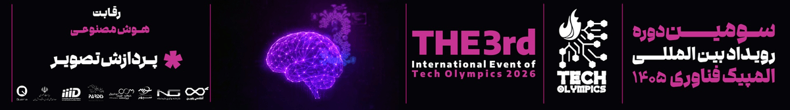

<div align="center">

# Team Chati Pati — Quera Image Processing Competition

[](https://python.org)
[](https://pytorch.org)
[](https://opencv.org)
[](LICENSE)

**A curated, competition-ready collection of Computer Vision projects built by Team Chati Pati for the Quera Image Processing Olympiad — Final Round.**

</div>

<p align="center"></p>

## About This Repository

This repository is the central hub for **Team Chati Pati**'s solutions to all challenges in the [Quera Image Processing Competition](https://quera.org). Each project directory contains a fully self-contained solution with its own dataset references, trained model weights, and detailed documentation.

The repository is organized by **Computer Vision discipline**, making it easy to cross-reference techniques and reuse components across challenges.

## Repository Structure

```
computer_vision_oly/
│
├── classification/                   # Image Classification tasks
│   ├── her_face/                        # Face-based classification
│   ├── machinebazi/                     # Multi-label car part classification (ResNet50)
│   ├── pool/                            # Pool classification challenge
│   └── watermark_detection/             # Watermark presence detection
│
├── object_detection/                 # Object Detection & Localization tasks
│   ├── football_analysis/               # YOLO-based football player analysis
│   └── offside/                         # Geometric football offside detection
│
├── ocr/                              # Optical Character Recognition tasks
│   └── ugly_handwriting/                # Handwritten character recognition
│
├── segmentation/                     # Pixel-Level Segmentation tasks
│   ├── avengers_shield/                 # 1D drone audio event segmentation (TCN)
│   ├── project_chrono_vision/           # YOLOv8 instance segmentation
│   └── ultravision_operation/           # Medical X-ray segmentation (UNet + CLIP)
│
├── geometry_and_puzzle_solving/      # NEW CATEGORY — Geometric & Structural reasoning
│   └── sudoku/                          # Sudoku board extraction + CNN digit recognition + solver
│
├── image_processing_fundamentals/   # NEW CATEGORY — Classical CV & Preprocessing
│   └── opencv/
│       ├── postcard/                    # FFT noise removal + watermark embedding
│       │   ├── watermark_v1.py
│       │   ├── watermark_v2.py          # Distance-transform glow effects
│       │   └── grid_search.py           # Parallel SSIM-optimized parameter search
│       ├── skin_finding/
│       │   └── skin.py                  # YCrCb + HSV dual-space skin detection
│       ├── sheet1.ipynb                 # OpenCV exercises: Sobel, Canny, ORB, Hough
│       └── video_gray.ipynb             # Grayscale video conversion pipeline
│
├── README.md
├── poster.jpg
├── image_processing_competition_43_day_notion.md
├── f495847_yolo-olympic.pptx
└── requirements.txt
```

## Category Descriptions

### Classification

Binary or multi-class image classification using deep learning backbones (ResNet, EfficientNet, CLIP ViT). Includes tasks such as car part identification, face classification, and watermark detection.

### Object Detection

Localizing and identifying objects within images. Includes classical geometric methods (offside line detection via color segmentation) as well as YOLO-based deep detection.

### OCR (Optical Character Recognition)

Recognizing text from images, including challenging handwritten or noisy inputs using convolutional sequence models and custom preprocessing.

### Segmentation

Pixel-level labeling including:

- **1D Temporal Segmentation** (audio/spectrogram event detection via TCN)
- **Medical Image Segmentation** (UNet on X-rays)
- **Instance Segmentation** (YOLOv8-seg)

### Geometry & Puzzle Solving

Problems requiring geometric reasoning, perspective correction, and structured constraint solving — e.g., extracting and solving Sudoku boards from photographs.

### Image Processing Fundamentals

Classical signal processing and preprocessing techniques: FFT-based noise removal, distance-transform watermarking, morphological skin detection, feature-based image alignment (ORB + RANSAC), and video processing.

## Setup & Installation

### Prerequisites

- Python 3.10 or higher
- CUDA-capable GPU (recommended for deep learning projects)
- `git` with `git-lfs` (for large model weight files)

### 1. Clone the Repository

```bash
git clone https://github.com/AliFazelniya/computer_vision_oly/
cd computer_vision_oly
```

### 2. Create a Virtual Environment

```bash
python -m venv .venv
source .venv/bin/activate      # Linux / macOS
# .venv\Scripts\activate       # Windows
```

### 3. Install Dependencies

```bash
pip install -r requirements.txt
```

### 4. Install Project-Specific Dependencies

Each project may require additional packages. Install them as needed:

### 5. Dataset Setup

Each project's `README.md` includes instructions for downloading and placing the dataset. General structure:

```
<project>/
  ├── train/      ← Training images (+ optional train.csv)
  ├── test/       ← Test images (+ test.csv)
  └── notebook.ipynb
```

## Quick Start

Navigate into any project and run its notebook:

```bash
cd classification/machinebazi
jupyter notebook notebook.ipynb
```

Or run standalone Python scripts:

```bash
cd object_detection/offside
python offside_detection.py
```

## Projects at a Glance

| Project                 | Category          | Core Technique                              | Competition Link                                                      |
| ----------------------- | ----------------- | ------------------------------------------- | --------------------------------------------------------------------- |
| `machinebazi`           | Classification    | ResNet50, class-weighted CE                 | [Quera](https://quera.org/problemset/307569)                          |
| `her_face`              | Classification    | Deep CNN                                    | [Quera](https://quera.org/problemset/251284)                          |
| `pool`                  | Classification    | CNN                                         | [Quera](https://quera.org/problemset/251285)                          |
| `watermark_detection`   | Classification    | CNN                                         | [Quera](https://quera.org/problemset/138169)                          |
| `offside`               | Object Detection  | Color segmentation + geometry               | [Quera](https://quera.org/contest/assignments/103147/problems/355584) |
| `football_analysis`     | Object Detection  | YOLOv8x                                     | [Quera](https://quera.org/problemset/307571)                          |
| `ugly_handwriting`      | OCR               | Custom CNN + seq model                      | [Quera](https://quera.org/problemset/292198)                          |
| `avengers_shield`       | Segmentation      | Dilated TCN + BoundaryRefiner               | [Quera](https://quera.org/contest/assignments/103147/problems/355588) |
| `ultravision_operation` | Segmentation      | CLIP ViT + UNet                             | [Quera](https://quera.org/contest/assignments/91552/problems/310514)  |
| `project_chrono_vision` | Segmentation      | YOLOv8l-seg                                 | [Quera](https://quera.org/contest/assignments/91552/problems/310516)  |
| `sudoku`                | Geometry & Puzzle | Perspective warp + SudokuCNN + backtracking | [Quera](https://quera.org/contest/assignments/103147/problems/355590) |
| `opencv`                | IP Fundamentals   | FFT, morphology, ORB, Hough                 | [OpenCV](https://docs.opencv.org/5.0/)                                |

## 🤝 Team

**Team Chati Pati** — Competing in the Quera Image Processing Olympiad, Final Round.

## 📄 License

This repository is for educational and competition purposes. All code is released under the [MIT License](LICENSE) unless otherwise specified.
